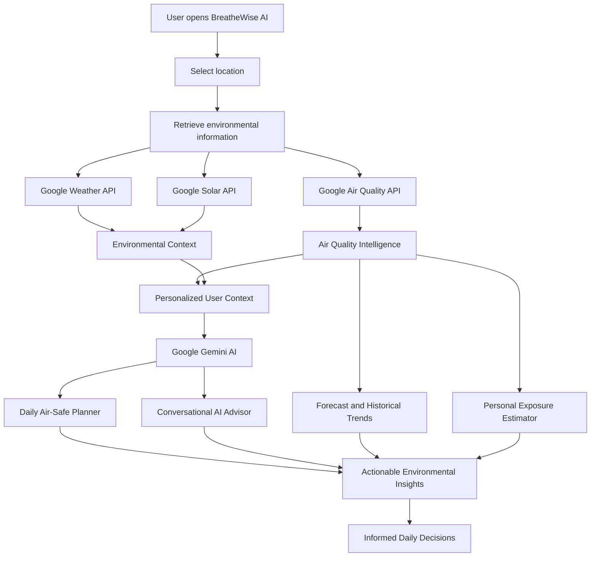

# 🌍 BreatheWise AI

### Breathe Smarter. Protect Your Family. Live Sustainably.

**An AI-powered Urban Air Quality Intelligence Platform that transforms real-time pollution data into personalized, actionable insights for healthier daily decisions.**

### 🚀 Project Links

[**Live Application**](https://breathewise-ai.ai.studio) | [**GitHub Repository**](https://github.com/instathoughts7-ai/BreatheWise-AI)

### 🛠️ Built With


---

# 🌍 BreatheWise AI

### Breathe Smarter. Protect Your Family. Live Sustainably.

**An AI-powered Urban Air Quality Intelligence Platform that transforms real-time pollution data into personalized, actionable insights for healthier daily decisions.**

---


## 📌 Table of Contents

1. [Project Overview](#-project-overview)
2. [Problem Statement](#-problem-statement)
3. [Our Solution](#-our-solution)
4. [Key Features](#-key-features)
5. [What Makes BreatheWise AI Different](#-what-makes-breathewise-ai-different)
6. [How It Works](#-how-it-works)
7. [Technology Stack](#-technology-stack)
8. [Google Services Integration](#-google-services-integration)
9. [System Architecture](#-system-architecture)
10. [AI and Data Intelligence](#-ai-and-data-intelligence)
11. [Security and Privacy](#-security-and-privacy)
12. [Testing and Quality Assurance](#-testing-and-quality-assurance)
13. [Accessibility](#-accessibility)
14. [Installation and Setup](#-installation-and-setup)
15. [Environment Configuration](#-environment-configuration)
16. [API Endpoints](#-api-endpoints)
17. [Project Structure](#-project-structure)
18. [Evaluation Criteria](#-evaluation-criteria)
19. [Known Limitations and Future Roadmap](#-known-limitations-and-future-roadmap)
20. [Live Demo and Repository](#-live-demo-and-repository)
21. [Contributing](#-contributing)
22. [License](#-license)

---

## 🌱 Project Overview

Air pollution is one of the major environmental challenges facing modern cities.

During winter, severe smog and deteriorating air quality can affect how families commute, exercise, work, study and spend time outdoors.

Although air-quality monitoring applications provide pollution readings, understanding what those readings mean and deciding what to do next can be difficult.

**BreatheWise AI bridges the gap between air-quality data and everyday decision-making.**

It combines Google Maps Platform, Google Gemini and Firebase to provide an intelligent air-quality experience.

The application helps users:

- Understand local air-quality conditions.
- Monitor PM2.5, PM10 and other available pollutants.
- Explore historical and forecast air-quality trends.
- Identify potentially better outdoor activity windows.
- Estimate personal PM2.5 inhalation under different activity scenarios.
- Generate personalized daily air-quality plans.
- Ask questions through a conversational AI assistant.
- Explore UV, weather and solar potential information.
- Save personal preferences, locations and daily plans.

### Our Mission

**Make air-quality information understandable, personalized and actionable so individuals and families can make more informed everyday decisions.**

---

## 🚨 Problem Statement

### Challenge 6 — Urban Air Quality Assistant

Create a GenAI-powered assistant that helps families and communities navigate severe winter smog and urban air pollution.

The application should suggest:

- Low-emission daily routines.
- Indoor air-quality improvements.
- Sustainable alternatives.
- Location- and lifestyle-aware recommendations.
- Clear explanations of the impact of individual choices.

### The Challenges

| Challenge                  | Why it matters                                              |
| -------------------------- | ----------------------------------------------------------- |
| Complex AQI information    | Users may not understand pollution measurements             |
| Changing air quality       | Conditions can vary throughout the day                      |
| Outdoor activity decisions | People need practical guidance on activity timing           |
| Indoor pollution           | Indoor environments also require attention                  |
| Personal exposure          | Different activities can involve different inhalation rates |
| Generic recommendations    | Household routines and sensitivity preferences differ       |

---

## 💡 Our Solution

BreatheWise AI is a location-aware air-quality intelligence and decision-support platform.

Rather than simply displaying AQI numbers, it combines environmental information with AI-generated explanations and personalized daily recommendations.

The application focuses on four important questions:

1. What is the current air quality around me?
2. How might air quality change throughout the day?
3. What should I consider before planning outdoor activities?
4. What practical steps can help me make more informed decisions?

---

## 🚀 Key Features

### 1. 🌍 Real-Time Air Quality Intelligence

Powered by Google Maps Platform Air Quality API.

**Capabilities:**

- Location-based air-quality information.
- Universal AQI (UAQI) and US EPA AQI where returned by the provider.
- PM2.5 and PM10 information where available.
- Dominant pollutant identification.
- Pollutant concentration details.
- Health recommendation information supplied by the provider.
- AQI category classification.
- Data timestamps and source identification.
- Interactive air-quality heatmap tiles.

**Value:** Understand local air-quality conditions using structured environmental data.

### 2. 📍 Smart Location Intelligence

Users can explore air quality in different locations.

**Capabilities:**

- Search for a city or address.
- Use current device location with browser permission.
- Reverse geocoding.
- Quick city selection.
- Interactive Google Maps visualization.
- Save frequently used locations through Firebase.

**Value:** Make location-aware air-quality decisions.

### 3. 📈 Air Quality Forecast and Historical Trends

Air quality is not static. Understanding changes over time helps users make better plans.

**Capabilities:**

- Hourly air-quality forecast.
- Historical air-quality information.
- AQI trend visualization.
- Chart and table display modes.
- Forecast and history views.
- Identification of potentially cleaner outdoor windows.
- Identification of higher-risk periods.

**Value:** Understand changing environmental conditions rather than relying only on one reading.

### 4. 🤖 AI Daily Air-Safe Planner

Powered by Google Gemini.

Generate personalized daily plans using:

- Selected location.
- Current air-quality conditions.
- Dominant pollutant.
- PM2.5 information.
- UV index where available.
- Selected sensitivity profile.
- Planned daily activities.

**Example activities:**

- Morning commute.
- Outdoor walking.
- School pickup.
- Cycling.
- Exercise.
- Evening groceries.

The AI planner generates:

- Daily headline.
- Air-quality summary.
- Suggested activity window.
- Risk-level explanation.
- Time-based recommendations.
- Indoor-air action suggestions.
- Safety disclaimer.

**Value:** Turn environmental information into practical daily guidance.

### 5. 🧮 Personal Exposure Estimator

One of the key interactive features of BreatheWise AI.

The Personal Exposure Estimator helps users compare modeled PM2.5 inhalation across different activity scenarios.

**Available activity intensities:**

- Resting.
- Brisk walking.
- Vigorous running.

**Adjustable session duration:**

15–120 minutes.

**Comparison scenarios:**

| Scenario               | Description                                            |
| ---------------------- | ------------------------------------------------------ |
| Unfiltered Outdoors    | Baseline estimated inhaled PM2.5                       |
| Closed-Window Indoors  | Modeled scenario using an assumed reduction            |
| Well-Fitted N95 / KN95 | Modeled scenario using an assumed filtration reduction |

The calculator uses the available PM2.5 concentration, activity intensity, duration and modeled assumptions.

**Important:** These are estimates, not direct personal exposure measurements. Actual results vary with ventilation, mask fit, breathing rate, indoor filtration and environmental conditions.

**Value:** Help users understand how activity duration and protective scenarios can influence estimated particulate inhalation.

### 6. 💬 BreatheWise AI Advisor

A conversational assistant powered by Google Gemini.

Users can ask questions about their current environmental conditions.

**Example questions:**

- Is it safe for a 45-minute outdoor run right now?
- Which pollutant is driving today's AQI?
- When should I open windows for indoor ventilation?
- Should I consider an N95 mask during my commute?
- What does PM2.5 mean?
- How should I plan outdoor activities today?

The assistant uses the active air-quality telemetry and household sensitivity preferences as contextual information.

**Responsible AI principles:**

- Ground responses in available environmental information.
- Avoid unsupported medical claims.
- Include appropriate safety notices.
- Validate generated responses.
- Reject unsafe medical directives.

**Value:** Make air-quality information easier to understand through natural conversation.

### 7. ☀️ Solar and UV Intelligence

Combines Google Weather API and Google Solar API.

**Google Weather capabilities:**

- Current UV index.
- Daytime/nighttime information.
- Temperature.
- Cloud cover.
- Relative humidity.
- Weather summary.

**Google Solar capabilities:**

- Maximum annual sunshine potential.
- Median annual sunshine information where available.
- Roof area information where returned.
- Imagery quality.
- Imagery date.
- Solar carbon-offset factor where returned.

**Value:** Provide additional environmental context beyond air-quality readings.

**Note:** Solar roof information depends on available building imagery and provider coverage. Sample baseline data is clearly distinguished from live provider data.

### 8. 👤 Firebase-Powered Personalization

Firebase Authentication and Cloud Firestore support user-specific experiences.

**Implemented capabilities:**

- Google Sign-In.
- User profile management.
- Saved sensitivity preferences.
- AQI standard preferences.
- Saved locations.
- Saved daily plans.
- User-specific Firestore data organization.

**Value:** Enable personalized experiences and persistent user preferences.

---

## ⭐ What Makes BreatheWise AI Different?

| Traditional air-quality application | BreatheWise AI                             |
| ----------------------------------- | ------------------------------------------ |
| Displays AQI readings               | Explains environmental conditions          |
| Static pollution information        | Forecast and historical trends             |
| General recommendations             | Gemini-powered daily planning              |
| Limited exposure context            | Interactive PM2.5 exposure estimator       |
| Separate environmental information  | Air quality, weather, UV and solar context |
| Basic user experience               | Firebase-powered saved preferences         |
| Fixed information                   | Conversational AI assistance               |

### Our Core Differentiator

**From Air Quality Monitoring to AI-Powered Daily Decision Support.**

---

## 🔄 How It Works



---

## 🛠️ Technology Stack

| Layer           | Technology                           | Purpose                         |
| --------------- | ------------------------------------ | ------------------------------- |
| Frontend        | React 19                             | User interface                  |
| Language        | TypeScript                           | Type-safe development           |
| Styling         | Tailwind CSS                         | Responsive design               |
| Icons           | Lucide React                         | Interface icons                 |
| Motion          | Motion                               | UI animations                   |
| Maps            | Google Maps JavaScript API           | Interactive map                 |
| Air Quality     | Google Maps Platform Air Quality API | AQI and pollutant data          |
| Geocoding       | Google Maps Platform Geocoding API   | Location search                 |
| Generative AI   | Google Gemini API                    | AI planner and assistant        |
| Weather         | Google Weather API                   | UV and weather telemetry        |
| Solar           | Google Solar API                     | Solar potential information     |
| Authentication  | Firebase Authentication              | Google Sign-In                  |
| Database        | Cloud Firestore                      | User preferences and saved data |
| Backend         | Node.js and Express                  | API services                    |
| Validation      | Zod                                  | Request and response validation |
| Testing         | Node.js Test Runner                  | Automated tests                 |
| Build Tool      | Vite                                 | Frontend development and build  |
| Version Control | Git and GitHub                       | Source management               |

---

## ☁️ Google Services Integration

Google technologies power the core application experience.

### Google Gemini API

Used for:

- Personalized daily air-quality plans.
- Context-aware recommendations.
- Natural-language explanations.
- Conversational environmental assistance.
- Structured AI-generated responses.

Documentation: [https://ai.google.dev/](https://ai.google.dev/)

### Google Maps Platform Air Quality API

Used for:

- Current air-quality conditions.
- Hourly forecast.
- Historical air-quality information.
- Pollutant concentrations.
- Air-quality heatmap tiles.
- Provider health recommendations.

Documentation: [https://developers.google.com/maps/documentation/air-quality](https://developers.google.com/maps/documentation/air-quality)

### Google Maps Platform Geocoding API

Used for:

- Address search.
- Forward geocoding.
- Reverse geocoding.
- Location identification.

Documentation: [https://developers.google.com/maps/documentation/geocoding](https://developers.google.com/maps/documentation/geocoding)

### Google Weather API

Used for:

- Current weather conditions.
- UV index.
- Temperature.
- Humidity.
- Cloud cover.
- Weather descriptions.

Documentation: [https://developers.google.com/maps/documentation/weather](https://developers.google.com/maps/documentation/weather)

### Google Solar API

Used for:

- Building solar insights.
- Roof sunshine potential.
- Solar-related information.
- Available roof and imagery metadata.

Documentation: [https://developers.google.com/maps/documentation/solar](https://developers.google.com/maps/documentation/solar)

### Firebase

Used for:

- Google authentication.
- User profiles.
- Saved locations.
- Saved daily plans.
- Persistent user preferences.

Documentation: [https://firebase.google.com/docs](https://firebase.google.com/docs)

---

## 🏗️ System Architecture

BreatheWise AI follows a modular full-stack architecture.

```text
BreatheWise-AI/
│
├── src/
│   ├── components/
│   │   ├── AirQualityMap.tsx
│   │   ├── AqiStatusBadge.tsx
│   │   ├── AssistantPanel.tsx
│   │   ├── DailyPlanPanel.tsx
│   │   ├── ExposureCalculator.tsx
│   │   ├── ForecastPanel.tsx
│   │   ├── SolarUvCard.tsx
│   │   └── ErrorBoundary.tsx
│   │
│   ├── contexts/
│   │   └── FirebaseContext.tsx
│   │
│   ├── lib/
│   │   ├── apiClient.ts
│   │   └── firebase.ts
│   │
│   ├── server/
│   │   ├── airQualityService.ts
│   │   ├── geminiService.ts
│   │   ├── solarUvService.ts
│   │   ├── cache.ts
│   │   ├── rateLimit.ts
│   │   ├── security.ts
│   │   ├── sampleBaseline.ts
│   │   └── app.ts
│   │
│   ├── shared/
│   │   ├── types.ts
│   │   ├── validation.ts
│   │   └── airQualityUtils.ts
│   │
│   ├── App.tsx
│   ├── index.css
│   └── main.tsx
│
├── tests/
│   ├── airQualityUtils.test.ts
│   ├── validationAndSafety.test.ts
│   └── serverApi.test.ts
│
├── .env.example
├── .gitignore
├── firestore.rules
├── firebase-blueprint.json
├── security_spec.md
├── package.json
├── server.ts
├── tsconfig.json
├── vite.config.ts
└── README.md
```

### Architecture Principles

- Modular separation of frontend, backend and shared logic.
- Server-side external API integration.
- Reusable environmental data services.
- Typed application data models.
- Centralized request validation.
- Caching and rate limiting.
- Explicit fallback behavior.
- Firebase user-data isolation.

---

## 🧠 AI and Data Intelligence

BreatheWise AI distinguishes between provider data, forecasts, AI-generated guidance and modeled estimates.

| Data type             | Description                                                         |
| --------------------- | ------------------------------------------------------------------- |
| Live provider data    | Information returned by Google services                             |
| Forecast data         | Provider-generated future air-quality information                   |
| Historical data       | Previously recorded provider information                            |
| AI-generated guidance | Gemini-generated recommendations using supplied context             |
| Modeled estimates     | Calculations using documented assumptions                           |
| Sample baseline       | Clearly identified fallback data used when live data is unavailable |

### AQI Interpretation

The application supports two AQI standards:

- Universal AQI (UAQI).
- US EPA AQI.

The classification logic accounts for the difference between these scales:

- Higher UAQI values indicate cleaner air.
- Lower US EPA AQI values indicate cleaner air.

The application selects the preferred available index and handles unavailable alternatives.

### Important Data Coverage Consideration

AQI standards, pollutants and provider coverage vary by location.

The application should not present Universal AQI as India's official CPCB AQI.

Where local regulatory AQI interpretation is required, an appropriate verified local data source and its methodology should be integrated separately.

---

## 🔐 Security and Privacy

Security is integrated into the application architecture.

### Backend Security

- API keys are accessed through server-side environment variables.
- Express disables its default `X-Powered-By` header.
- Request body size is limited.
- Zod validates incoming API requests.
- User-provided text is sanitized.
- Standard and AI endpoints use rate limiting.
- Error messages are summarized to avoid exposing sensitive credentials.
- Responses include defensive security headers.

### Firebase Security

Firestore security rules enforce:

- Authentication requirements.
- Email-verified writes.
- Owner-only user access.
- User-specific document paths.
- Strict document field validation.
- Coordinate validation.
- Immutable identity and creation fields.
- Bounded saved-plan data.
- Default-deny access.

### Privacy Principles

- Collect only information required for application functionality.
- Request location permission through the browser.
- Keep user records scoped to their authenticated identity.
- Avoid exposing credentials in frontend bundles.
- Avoid logging sensitive user information.
- Provide clear distinctions between live and sample data.

**Security note:** Review API key restrictions, Firebase rules deployment and production secrets configuration before public production deployment.

---

## 🧪 Testing and Quality Assurance

Automated tests are included in the repository.

The test suite contains **23 test cases across three test files**.

### 1. Air Quality Utility Tests

File: `tests/airQualityUtils.test.ts`

Validates:

- Universal AQI classification.
- US EPA AQI classification.
- Preferred index selection and fallback.
- WHO pollutant guideline ratios.
- PM2.5 inhalation impact calculations.
- Activity intensity scenarios.
- Cleaner outdoor activity windows.
- Sensitivity-profile recommendations.
- WHO UV index classification.

### 2. Validation and Safety Tests

File: `tests/validationAndSafety.test.ts`

Validates:

- User-input sanitization.
- Coordinate validation.
- Invalid numeric input handling.
- Geocoding query validation.
- Heatmap tile parameter validation.
- API-key and bearer-token redaction.
- Safe error-message handling.
- Unsafe AI-generated medical advice detection.
- Assistant response safety.

### 3. Backend API Tests

File: `tests/serverApi.test.ts`

Validates:

- Health endpoint.
- API secret non-disclosure.
- Current air-quality endpoint.
- Request validation.
- Response caching.
- API quota failure fallback.
- Forecast endpoint.
- Geocoding endpoint.
- Heatmap tile validation.
- Gemini daily-plan endpoint.
- Gemini assistant endpoint.
- Unsafe AI response rejection.
- Solar and Weather API integration.
- Solar and Weather fallback behavior.

### Run Tests

```bash
npm test
```

### Run TypeScript Checks

```bash
npm run lint
```

### Run Production Build

```bash
npm run build
```

### Run ESLint on Firestore Rules

```bash
npm run lint:rules
```

**Testing transparency:** The repository includes these automated test cases. Execute the commands in your environment and verify the results before reporting them as passing.

---

## ♿ Accessibility

BreatheWise AI includes accessibility-focused implementation practices.

- Semantic HTML.
- Accessible component labels.
- Keyboard-operable controls.
- Visible text-based AQI status indicators.
- Accessible chart descriptions.
- Screen-reader announcements for dynamic content.
- Form labels and validation messages.
- Responsive layouts.
- Non-color status communication.

The accessibility objective is to align with WCAG 2.2 AA. A complete independent accessibility audit is still required before claiming full compliance.

---

## 💻 Installation and Setup

### Prerequisites

- Node.js LTS.
- npm.
- Git.
- Google AI Studio / Gemini API access.
- Google Maps Platform project.
- Firebase project for authentication and persistence.

### 1. Clone the Repository

```bash
git clone https://github.com/instathoughts7-ai/BreatheWise-AI.git

cd BreatheWise-AI
```

### 2. Install Dependencies

```bash
npm install
```

### 3. Configure Environment Variables

Copy the example environment file:

```bash
cp .env.example .env
```

On Windows PowerShell:

```powershell
Copy-Item .env.example .env
```

Add your actual credentials and configuration values.

### 4. Start the Development Server

```bash
npm run dev
```

### 5. Build for Production

```bash
npm run build
```

### 6. Run Tests

```bash
npm test
```

### 7. Start the Application

```bash
npm start
```

Use the scripts in `package.json` and configure production environment variables before deployment.

---

## 🔑 Environment Configuration

The project includes an `.env.example` file.

Example:

```env
# Google Gemini API
GEMINI_API_KEY=your_gemini_api_key

# Server-side Google Maps Platform API key
GOOGLE_MAPS_API_KEY=your_server_maps_api_key

# Optional browser-side Google Maps JavaScript API key
VITE_GOOGLE_MAPS_API_KEY=your_browser_maps_api_key

# Application URL
APP_URL=http://localhost:5173
```

### Required Configuration

**Gemini API**

Enable Gemini API access and configure the server-side API key.

**Google Maps Platform**

Enable the APIs required by the implementation:

- Air Quality API.
- Geocoding API.
- Maps JavaScript API, if interactive maps are enabled.
- Weather API.
- Solar API.

**Firebase**

Configure the Firebase project and application configuration. Deploy the repository's Firestore security rules before enabling persistent user data.

### API Key Security

- Never commit actual `.env` files.
- Never expose the server-side Gemini API key.
- Restrict browser-side API keys by allowed referrers and APIs.
- Restrict server-side keys to required APIs and appropriate server environments.
- Use secure production secret management.
- Rotate any accidentally exposed credentials.

---

## 🔌 Backend API Endpoints

The Express backend exposes the following routes.

| Method | Endpoint                                   | Purpose                                  |
| ------ | ------------------------------------------ | ---------------------------------------- |
| GET    | `/api/health`                              | Application health and capability status |
| POST   | `/api/air-quality/current`                 | Current AQI and pollutant information    |
| POST   | `/api/air-quality/forecast`                | Air-quality forecast                     |
| POST   | `/api/air-quality/history`                 | Historical air-quality information       |
| GET    | `/api/air-quality/tiles/:mapType/:z/:x/:y` | Air-quality heatmap tiles                |
| POST   | `/api/geocode`                             | Address geocoding                        |
| POST   | `/api/geocode/reverse`                     | Reverse geocoding                        |
| POST   | `/api/gemini/plan`                         | AI daily plan generation                 |
| POST   | `/api/gemini/chat`                         | Conversational AI assistant              |
| POST   | `/api/environment/solar-uv`                | Solar and UV telemetry                   |

The endpoints use request validation and appropriate rate limiting.

---

## 🏆 Evaluation Criteria

BreatheWise AI is developed with the six evaluation focus areas as engineering priorities.

| Evaluation area | Implementation focus                                                  |
| --------------- | --------------------------------------------------------------------- |
| Code Quality    | React, TypeScript, modular services and shared utilities              |
| Security        | Server-side secrets, validation, rate limiting and Firestore rules    |
| Efficiency      | Caching, request optimization and reusable service logic              |
| Testing         | Utility, validation, safety and backend API tests                     |
| Accessibility   | Semantic markup, accessible labels and non-color status communication |
| Google Services | Gemini, Maps Air Quality, Geocoding, Weather, Solar and Firebase      |

### Our Goal

Achieve the highest possible score in all six evaluation areas through working implementation, documented architecture and verifiable testing evidence.

We do not treat an unimplemented feature, unexecuted test or unverified integration as completed.

---

## 🗺️ Known Limitations and Future Roadmap

The current implementation focuses on air-quality intelligence, forecasting, personalized recommendations, exposure estimation and environmental context.

The following are potential future enhancements and should not be confused with existing functionality.

### Phase 1 — Core Intelligence

- [x] Current air-quality integration.
- [x] Pollutant information.
- [x] AQI classification.
- [x] Location search.
- [x] Air-quality map visualization.
- [x] Forecast and historical views.
- [x] Gemini-powered daily planner.
- [x] Conversational AI assistant.

### Phase 2 — Environmental Intelligence

- [x] Personal exposure estimator.
- [x] Google Weather integration.
- [x] Google Solar integration.
- [x] UV index information.
- [x] Solar potential information.
- [x] Sample-data fallback handling.

### Phase 3 — Personalization and Security

- [x] Firebase Google Sign-In.
- [x] Saved user preferences.
- [x] Saved locations.
- [x] Saved daily plans.
- [x] Firestore security rules.
- [x] API request validation.
- [x] Automated safety tests.

### Phase 4 — Future Enhancements

- [ ] Dedicated Green Commute comparison and emissions calculator.
- [ ] Dedicated Indoor Air Shield household checklist.
- [ ] Air Action Simulator comparing existing and improved routines.
- [ ] Community participation dashboard.
- [ ] Multilingual support: English, Hindi and Marathi.
- [ ] Voice-enabled AI assistant.
- [ ] Verified India-specific CPCB AQI integration.
- [ ] Push notifications for significant air-quality changes.
- [ ] Smart-home and IoT sensor integration.
- [ ] Expanded accessibility and independent security audits.

---

## 🌐 Live Demo and Repository

### 🚀 Try BreatheWise AI

[https://breathewise-ai.ai.studio](https://breathewise-ai.ai.studio)

Explore the application and experience its air-quality intelligence, forecasting, AI recommendations and environmental insights.

### 💻 GitHub Repository

[https://github.com/instathoughts7-ai/BreatheWise-AI](https://github.com/instathoughts7-ai/BreatheWise-AI)

Explore the source code, backend architecture, automated tests, Firebase security rules and implementation details.

### 🛠️ Built With

- Google Gemini.
- Google Maps Platform.
- Google Air Quality API.
- Google Weather API.
- Google Solar API.
- Firebase.
- React.
- TypeScript.
- Node.js.

---

## 🤝 Contributing

Contributions, suggestions and improvements are welcome.

### Contribution Steps

1. Fork the repository.
2. Create a feature branch.
3. Implement your changes.
4. Run the available tests.
5. Verify the production build.
6. Submit a pull request with a clear description.

Please do not submit API credentials, private keys or personal information.

---

## 📜 License

This project is distributed under the MIT License.

See the [LICENSE](LICENSE) file for details.

---

## 🙌 Acknowledgements

Built with the power of Google AI, Google Maps Platform, Firebase and the open-source developer ecosystem.

Special thanks to the teams and communities building tools that make environmental intelligence more accessible.

---

## 🌍 Our Vision

Air pollution is a shared challenge. Better information can help people make more informed everyday decisions.

BreatheWise AI aims to make environmental intelligence personal, understandable and actionable.

We believe that the future of air-quality awareness is not just about knowing the AQI.

It is about understanding the information, adapting our routines and making thoughtful choices.

### **BreatheWise AI**

### Breathe Smarter. Protect Your Family. Live Sustainably.

**Challenge:** Challenge 6 — Urban Air Quality Assistant
**GitHub:** [https://github.com/instathoughts7-ai/BreatheWise-AI](https://github.com/instathoughts7-ai/BreatheWise-AI)
**Live Application:** [https://breathewise-ai.ai.studio](https://breathewise-ai.ai.studio)

